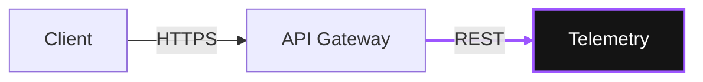

# Diagrams, flows and charts

Three surfaces: UI pages, 16:9 slides, and Markdown-authored diagrams. One rule for all three: the diagram is built from the brand tokens, never from a library's defaults.

Read `tailwind-and-tokens.md` first. Everything here reuses `--color-bg-body`, `--color-bg-card`, `--color-text-main`, `--color-text-muted`, `--color-border`, `--color-primary`, `--color-accent`.

## 0. Chart tokens (append to `@theme`)

The data palette is additive. Five steps, derived from the existing tokens, not invented:

| Token | Dark | Light | Role |
| --- | --- | --- | --- |
| `--color-chart-1` | `#9d56ff` | `#6200ea` | The one datum you are arguing about |
| `--color-chart-2` | `#ffffff` | `#1a1a1a` | Primary context series |
| `--color-chart-3` | `#9ea0af` | `#5b6270` | Mid context; light-mode lines |
| `--color-chart-4` | `#63646d` | `#93979f` | Background series; dark-mode lines |
| `--color-chart-5` | `#36373c` | `#bcbec3` | Area fill, axes, grid, tracks |
| `--color-chart-alert` | `#f87171` | `#dc2626` | Negative delta only, never a series |

`chart-4` is `--color-text-muted` at 60% over the canvas and `chart-5` at 30%, so both are reproducible. Measured contrast against the canvas: `chart-3` 7.64 (dark) / 4.91 (light), `chart-4` 3.37 / 2.35, `chart-5` 1.67 / 1.28. **Consequence: light-mode lines use `chart-3`, dark-mode lines use `chart-4`.** `chart-5` is never a line, only a fill.

```css
@theme {
  --color-chart-1: #6200ea;
  --color-chart-2: #1a1a1a;
  --color-chart-3: #5b6270;
  --color-chart-4: #93979f;
  --color-chart-5: #bcbec3;
  --color-chart-alert: #dc2626;
  --color-chart-line: #5b6270;
}

:root.dark,
:root[data-theme='dark'] {
  --color-chart-1: #9d56ff;
  --color-chart-2: #ffffff;
  --color-chart-3: #9ea0af;
  --color-chart-4: #63646d;
  --color-chart-5: #36373c;
  --color-chart-alert: #f87171;

  --color-chart-line: #63646d;
}
```

Same split as the base tokens: `@theme` carries the light values and `:root.dark` swaps them. `--font-mono` is declared once, in `tailwind-and-tokens.md`.

```css
@keyframes data-flow {
  from {
    stroke-dashoffset: 24;
  }
  to {
    stroke-dashoffset: 0;
  }
}

@layer utilities {
  /* One animated path per diagram, never more. */
  .flow-line {
    stroke-dasharray: 2 4;
    animation: data-flow 1.2s linear infinite;
  }

  /* Glow is theme-aware and only ever applied to chart-1. */
  .glow-accent {
    filter: drop-shadow(0 0 6px color-mix(in oklab, var(--color-accent) 45%, transparent));
  }
}

@media (prefers-reduced-motion: reduce) {
  .flow-line {
    animation: none;
  }
}
```

## 1. Architecture diagrams: Astro + Tailwind + SVG

### 1.1 `DiagramNode.astro`

Radii cascade `rounded-xl` (node) → `rounded-lg` (icon plate) → `rounded-md` (protocol badge). The node is a mini-card: it must not compete with the 32px card it may sit inside.

```astro
---
type IconComponent = (typeof import('lucide-astro'))['Cpu']

interface Props {
  title: string
  subtitle?: string
  icon?: IconComponent
  protocol?: string
  port?: string
  status?: 'active' | 'idle' | 'alert'
  class?: string
}

const { title, subtitle, icon: Icon, protocol, port, status = 'idle', class: className } = Astro.props

const dots = { active: 'bg-accent', idle: 'bg-ink-muted/50', alert: 'bg-red-400' }
const labels = { active: 'Active', idle: 'Idle', alert: 'Alert' }
---

<article
  class:list={[
    'group relative flex flex-col gap-3 rounded-xl border border-line bg-surface/95 p-4 backdrop-blur-md',
    'transition-colors duration-300 hover:border-primary/40',
    className,
  ]}
>
  <div class="flex items-start gap-3">
    {
      Icon && (
        <span class="flex h-9 w-9 shrink-0 items-center justify-center rounded-lg bg-primary/10 text-primary">
          <Icon class="h-4 w-4" aria-hidden="true" />
        </span>
      )
    }
    <div class="min-w-0 flex-1">
      <h3 class="truncate text-sm font-bold text-ink">{title}</h3>
      {subtitle && <p class="truncate text-xs font-light leading-relaxed text-ink-muted">{subtitle}</p>}
    </div>
    <span
      class:list={['mt-1 h-1.5 w-1.5 shrink-0 rounded-full', dots[status]]}
      role="img"
      aria-label={labels[status]}
    ></span>
  </div>

  {
    (protocol || port) && (
      <div class="flex items-center gap-2 border-t border-line pt-3">
        {protocol && (
          <span class="rounded-md border border-line px-1.5 py-0.5 font-mono text-[10px] font-bold tracking-widest text-accent uppercase">
            {protocol}
          </span>
        )}
        {port && <span class="font-mono text-[10px] text-ink-muted tabular-nums">{port}</span>}
      </div>
    )
  }
</article>
```

`alert` is the only place a red is legal here, and it is semantic (it already exists for form errors), never a data series.

### 1.2 `DiagramCluster.astro`

```astro
---
interface Props {
  label: string
  class?: string
}

const { label, class: className } = Astro.props
---

<div class:list={['relative rounded-3xl border border-dashed border-line p-4 pt-6', className]}>
  <span class="absolute -top-2.5 left-4 rounded-md bg-canvas px-2 font-mono text-[10px] font-bold tracking-widest text-ink-muted uppercase">
    {label}
  </span>
  <slot />
</div>
```

Cluster is `rounded-3xl` (24) and always `border-dashed`: dashes mean "boundary", never "disabled". The label sits on the canvas colour so it cuts the border.

### 1.3 `Connector.astro` for linear flows

Zero coordinates, works at any width, no JS. Use it for `Client -> Gateway -> Service` chains.

```astro
---
interface Props {
  label?: string
  active?: boolean
  orientation?: 'horizontal' | 'vertical'
}

const { label, active = false, orientation = 'horizontal' } = Astro.props
const horizontal = orientation === 'horizontal'
---

<div class:list={['flex items-center', horizontal ? 'flex-row' : 'flex-col']}>
  <span class:list={['bg-line', horizontal ? 'h-px w-12' : 'h-12 w-px', active && 'bg-accent/60']}></span>
  <svg
    class:list={['h-2 w-2 shrink-0 text-line', active && 'text-accent', !horizontal && 'rotate-90']}
    viewBox="0 0 8 8"
    fill="none"
    stroke="currentColor"
    stroke-width="1.5"
    aria-hidden="true"
  >
    <path d="M1 1l4 3-4 3" stroke-linecap="round" stroke-linejoin="round"></path>
  </svg>
  {label && <span class="ml-2 font-mono text-[10px] tracking-widest text-ink-muted uppercase">{label}</span>}
</div>
```

### 1.4 `DiagramCanvas.astro` for real architecture maps

The hard problem is connectors that survive reflow. Measuring nodes with JS is forbidden. Use a fixed logical canvas instead.

- Container: `aspect-[2/1]` + `[container-type:inline-size]`.
- SVG: `viewBox="0 0 1000 500"`, absolutely positioned, `pointer-events-none`.
- **Conversion rule: `1cqw = 10 viewBox units` on both axes** (the aspect is pinned, so a cqw is the same physical length horizontally and vertically).
- Nodes are placed with percentage arbitrary classes (`left-[4cqw] top-[20cqw] w-[18cqw]`), so they scale with the canvas.
- Paths are authored in the `0–1000 / 0–500` space. Never mix units.

```astro
---
interface Props {
  label?: string
  class?: string
}

const { label, class: className } = Astro.props
---

<figure class:list={['m-0', className]}>
  <div class="relative aspect-[2/1] w-full overflow-hidden rounded-3xl border border-line bg-canvas/60 [container-type:inline-size]">
    <slot name="svg" />
    <slot />
  </div>
  {label && <figcaption class="mt-3 text-center text-xs text-ink-muted">{label}</figcaption>}
</figure>
```

Worked example — four nodes at `x = 40, 300, 560, 820`, `y = 200`, `w = 180`, `h = 90`. In cqw: `left-[4cqw]`, `top-[20cqw]`, `w-[18cqw]`, `h-[9cqw]`. The vertical centre of every node is `y = 245` (`24.5cqw`).

```astro
---
import DiagramNode from '@components/diagrams/DiagramNode.astro'
import DiagramCanvas from '@components/diagrams/DiagramCanvas.astro'
import { Laptop, Server, Cpu, Database } from 'lucide-astro'
---

<DiagramCanvas label="Edge to cloud, MQTT over TLS">
  <svg
    slot="svg"
    class="pointer-events-none absolute inset-0 h-full w-full"
    viewBox="0 0 1000 500"
    fill="none"
    aria-hidden="true"
  >
    <!-- static structural edges -->
    <path d="M220 245 H300" stroke="var(--color-chart-line)" stroke-width="1" />
    <path d="M740 245 H820" stroke="var(--color-chart-line)" stroke-width="1" />
    <!-- the one active flow -->
    <path
      class="flow-line"
      d="M480 245 H560"
      stroke="var(--color-accent)"
      stroke-width="1.5"
      stroke-linecap="round"
    />
    <!-- arrowheads, drawn in user units: they stay square because the aspect is pinned -->
    <path d="M300 241 L305 245 L300 249" stroke="var(--color-chart-line)" stroke-width="1" />
    <path d="M820 241 L825 245 L820 249" stroke="var(--color-chart-line)" stroke-width="1" />
    <path d="M560 241 L565 245 L560 249" stroke="var(--color-accent)" stroke-width="1.5" />
  </svg>

  <div class="absolute left-[4cqw] top-[20cqw] h-[9cqw] w-[18cqw]">
    <DiagramNode title="Client" subtitle="Web app" icon={Laptop} protocol="HTTPS" status="idle" class="h-full" />
  </div>
  <div class="absolute left-[30cqw] top-[20cqw] h-[9cqw] w-[18cqw]">
    <DiagramNode title="API Gateway" subtitle="Rate limit" icon={Server} protocol="REST" status="active" class="h-full" />
  </div>
  <div class="absolute left-[56cqw] top-[20cqw] h-[9cqw] w-[18cqw]">
    <DiagramNode title="Telemetry" subtitle="Ingest" icon={Cpu} protocol="MQTT" port="tcp:1883" status="active" class="h-full" />
  </div>
  <div class="absolute left-[82cqw] top-[20cqw] h-[9cqw] w-[18cqw]">
    <DiagramNode title="Timescale" subtitle="Retention 90d" icon={Database} protocol="SQL" status="idle" class="h-full" />
  </div>
</DiagramCanvas>
```

Rules for this canvas: 3–6 nodes; edges orthogonal (straight or one 90° bend, never diagonal spaghetti); one `.flow-line` maximum; every edge either has an arrowhead or is explicitly bidirectional, never both.

## 2. Mermaid: official theme

For diagrams authored in Markdown, or where the shape is cheaper to express as text. Two complete init blocks, because `themeVariables` is frozen at `initialize()`: there is no runtime theme switch.

```html
<figure class="my-10">
  <div data-mermaid data-code={`flowchart LR
  A[Client] -->|HTTPS| B[API Gateway]
  B -->|REST| C[Telemetry]
  C -->|SQL| D[(Timescale)]`}></div>
  <figcaption class="mt-3 text-center text-xs text-ink-muted">Ingest path</figcaption>
</figure>
```

### 2.1 `MermaidDiagram.astro`

```astro
---
interface Props {
  code: string
  caption?: string
  class?: string
}

const { code, caption, class: className } = Astro.props
---

<figure class:list={['m-0', className]}>
  <div
    data-mermaid
    data-code={code}
    class="flex justify-center [&_svg]:mx-auto [&_svg]:h-auto [&_svg]:max-w-full"
  ></div>
  {caption && <figcaption class="mt-3 text-center text-xs text-ink-muted">{caption}</figcaption>}
</figure>

<script>
  const THEMES = {
    dark: {
      darkMode: true,
      background: '#0a0a0a',
      fontFamily: "'Rubik Variable', Rubik, sans-serif",
      fontSize: '16px',
      primaryColor: '#141414',
      mainBkg: '#141414',
      primaryTextColor: '#ffffff',
      textColor: '#e6e6e6',
      titleColor: '#ffffff',
      primaryBorderColor: '#272727',
      nodeBorder: '#272727',
      secondaryColor: '#1f1f1f',
      tertiaryColor: '#0a0a0a',
      clusterBkg: '#0a0a0a',
      clusterBorder: '#272727',
      lineColor: '#63646d',
      edgeLabelBackground: '#0a0a0a',
      actorBkg: '#141414',
      actorBorder: '#272727',
      actorTextColor: '#ffffff',
      signalColor: '#9ea0af',
      signalTextColor: '#e6e6e6',
      labelBoxBkgColor: '#141414',
      labelBoxBorderColor: '#272727',
      labelTextColor: '#e6e6e6',
      noteBkgColor: '#1f1f1f',
      noteBorderColor: '#272727',
      noteTextColor: '#e6e6e6',
      attributeBackgroundColorOdd: '#141414',
      attributeBackgroundColorEven: '#101010',
      pie1: '#9d56ff',
      pie2: '#9ea0af',
      pie3: '#63646d',
      pie4: '#36373c',
    },
    light: {
      darkMode: false,
      background: '#e6e6e6',
      fontFamily: "'Rubik Variable', Rubik, sans-serif",
      fontSize: '16px',
      primaryColor: '#ffffff',
      mainBkg: '#ffffff',
      primaryTextColor: '#1a1a1a',
      textColor: '#1a1a1a',
      titleColor: '#1a1a1a',
      primaryBorderColor: '#d4d4d4',
      nodeBorder: '#d4d4d4',
      secondaryColor: '#f3f4f6',
      tertiaryColor: '#e6e6e6',
      clusterBkg: '#e6e6e6',
      clusterBorder: '#d4d4d4',
      lineColor: '#5b6270',
      edgeLabelBackground: '#e6e6e6',
      actorBkg: '#ffffff',
      actorBorder: '#d4d4d4',
      actorTextColor: '#1a1a1a',
      signalColor: '#5b6270',
      signalTextColor: '#1a1a1a',
      labelBoxBkgColor: '#ffffff',
      labelBoxBorderColor: '#d4d4d4',
      labelTextColor: '#1a1a1a',
      noteBkgColor: '#f3f4f6',
      noteBorderColor: '#d4d4d4',
      noteTextColor: '#1a1a1a',
      attributeBackgroundColorOdd: '#ffffff',
      attributeBackgroundColorEven: '#f7f7f7',
      pie1: '#6200ea',
      pie2: '#5b6270',
      pie3: '#93979f',
      pie4: '#bcbec3',
    },
  } as const

  const isDark = () =>
    document.documentElement.classList.contains('dark') ||
    document.documentElement.dataset.theme === 'dark'

  let seq = 0

  const renderOne = async (mermaid: any, el: HTMLElement) => {
    const code = el.dataset.code?.trim()
    if (!code) return
    const theme = isDark() ? THEMES.dark : THEMES.light
    // Literal hex only: Mermaid does colour math on these values and chokes on var().
    mermaid.initialize({ startOnLoad: false, securityLevel: 'strict', theme: 'base', themeVariables: theme })
    try {
      const { svg } = await mermaid.render(`mermaid-${seq++}`, code)
      el.innerHTML = svg
    } catch {
      // Fail visible: show the source instead of an empty box.
      el.innerHTML = `<pre class="slide-code overflow-auto">${code}</pre>`
    }
  }

  const initMermaid = async () => {
    const nodes = Array.from(document.querySelectorAll<HTMLElement>('[data-mermaid]'))
    if (!nodes.length) return
    // Dynamic import: Mermaid is a separate chunk, never part of the page bundle.
    const mermaid = (await import('mermaid')).default
    for (const el of nodes) await renderOne(mermaid, el)
  }

  const initAndWatch = () => {
    initMermaid()

    // Re-render when the theme toggles: themeVariables cannot be switched live.
    const w = window as typeof window & { mermaidWatch?: boolean }
    if (w.mermaidWatch) return
    w.mermaidWatch = true

    let lastTheme = isDark()
    new MutationObserver(() => {
      const now = isDark()
      if (now === lastTheme) return
      lastTheme = now
      initMermaid()
    }).observe(document.documentElement, {
      attributes: true,
      attributeFilter: ['class', 'data-theme'],
    })
  }

  document.addEventListener('astro:page-load', initAndWatch)
</script>
```

Highlight one edge or node without touching `lineColor`. Mermaid reads these comments in the diagram source:



Notes that matter in production:

- Mermaid is ~700 kB. The dynamic `import()` keeps it out of every other page; never import it at module scope.
- `securityLevel: 'strict'` is mandatory: diagram source may come from CMS authors.
- Sequence diagrams need `actorBkg`, `actorBorder`, `signalColor`, `labelBox*`, `noteBkgColor`; ER diagrams need `attributeBackgroundColorOdd/Even`. They are already in the blocks above.
- Never call `mermaid.run()` on `astro:page-load` and also render manually: it double-renders and leaves stale ids.

## 3. Charts: CSS and SVG first

### 3.1 Horizontal progress / comparison

Track is `bg-surface-hover`, fill is `bg-primary`, numbers are `tabular-nums`. A 6px track with `rounded-md` is already fully round, so `rounded-full` is not needed.

```html
<div class="w-full">
  <div class="mb-2 flex items-baseline justify-between gap-4">
    <span class="text-xs font-bold tracking-widest text-ink-muted uppercase">Latencia p95</span>
    <span class="font-mono text-sm font-bold text-ink tabular-nums">38 ms</span>
  </div>
  <div class="h-1.5 w-full overflow-hidden rounded-md bg-surface-hover">
    <div class="h-full w-[38%] rounded-md bg-primary"></div>
  </div>
</div>
```

Comparison list: one accent bar, the rest `chart-4`.

```html
<div class="space-y-3">
  <!-- the datum you are arguing about -->
  <div class="flex items-center gap-3">
    <span class="w-28 shrink-0 text-sm text-ink">Firmware</span>
    <div class="h-2 flex-1 rounded-md bg-surface-hover">
      <div class="h-full w-[92%] rounded-md bg-primary"></div>
    </div>
    <span class="w-14 shrink-0 text-right font-mono text-sm text-ink tabular-nums">92%</span>
  </div>
  <!-- context -->
  <div class="flex items-center gap-3">
    <span class="w-28 shrink-0 text-sm text-ink-muted">Software</span>
    <div class="h-2 flex-1 rounded-md bg-surface-hover">
      <div class="h-full w-[41%] rounded-md bg-chart-4"></div>
    </div>
    <span class="w-14 shrink-0 text-right font-mono text-sm text-ink-muted tabular-nums">41%</span>
  </div>
</div>
```

### 3.2 Donut / ring

`pathLength="100"` removes the circumference math: `stroke-dasharray="72 100"` means 72%.

```html
<div class="flex items-center gap-6">
  <svg viewBox="0 0 120 120" class="h-28 w-28 -rotate-90" role="img" aria-label="Disponibilidad 72 por ciento">
    <circle cx="60" cy="60" r="48" fill="none" stroke="currentColor" class="text-chart-5" stroke-width="10" />
    <circle
      cx="60"
      cy="60"
      r="48"
      fill="none"
      stroke="currentColor"
      class="glow-accent text-accent"
      stroke-width="10"
      pathLength="100"
      stroke-dasharray="72 100"
      stroke-linecap="round"
    />
  </svg>
  <div>
    <div class="font-mono text-3xl font-extrabold text-ink tabular-nums">72%</div>
    <div class="text-xs font-bold tracking-widest text-ink-muted uppercase">Disponibilidad</div>
  </div>
</div>
```

`stroke-linecap="round"` matches the brand's rounded geometry. `glow-accent` only on the ring that carries the argument, never on the track.

### 3.3 Sparkline

```html
<svg
  viewBox="0 0 200 60"
  class="h-12 w-full"
  preserveAspectRatio="none"
  role="img"
  aria-label="Temperatura estable entre 21 y 24 grados en las últimas 24 horas"
>
  <polyline
    points="0,44 25,38 50,41 75,26 100,30 125,18 150,22 175,10 200,14"
    fill="none"
    stroke="currentColor"
    class="text-accent"
    stroke-width="2"
    stroke-linecap="round"
    stroke-linejoin="round"
    vector-effect="non-scaling-stroke"
  />
</svg>
```

`preserveAspectRatio="none"` lets one fixed `points` string stretch to any width; `vector-effect="non-scaling-stroke"` keeps the 2px stroke honest despite the stretch. Both are required: with one and not the other you get either a distorted shape or a fat stroke.

### 3.4 Categorical palette rules

1. Series values come only from `chart-1` … `chart-5`. Never a Tailwind colour family, never `--color-primary-light` (it is a hover state, not a series).
2. Exactly one series is `chart-1` per chart. If everything is accent, nothing is.
3. Order the ladder by importance, not by data order: the eye reads luminance before it reads the legend.
4. Maximum 5 series. Above that, group into "Other" or switch to a table.
5. `chart-alert` only for a negative delta that the chart is about. It is not a sixth series.
6. Never encode two series with the same luminance and different hue: on a projector they collapse. If two series must be distinguished at small size, use different dash patterns on lines.
7. Always label the datum: a chart with no numbers is decoration.

## 4. STRICT DO NOTs

| ❌ NEVER | ✅ INSTEAD |
| --- | --- |
| Mermaid `theme: 'default'` or `'forest'`, or `'base'` with partial `themeVariables` (blue boxes, yellow clusters). | The two complete init blocks above, with literal hex. |
| `themeVariables` built from `var(--color-*)`. | Literal hex: Mermaid does colour math on these values. |
| One global init and no re-render on theme change. | Re-init and re-render on `.dark` / `data-theme` mutation. |
| Connectors positioned by measuring nodes with JS. | Fixed `2:1` canvas, `cqw` nodes, `viewBox` units at `1cqw = 10`. |
| `stroke-width` above 2 on any edge, or heavy `shadow-*` on nodes. | 1–1.5 structural edges, 2 for the active one; depth from border plus surface. |
| More than one `.flow-line` per diagram. | One animated path; every other edge is static. |
| Rainbow series, or two series told apart only by hue. | `chart-1`…`chart-5` ladder; luminance carries the meaning. |
| `--color-secondary` as a data series. | It is `1.46:1` on the dark card: invisible. Use `chart-3`–`chart-5`. |
| Pie with more than 5 slices, 3D effects, dual y-axis, axis truncated above zero. | Bars for comparison; axis always from zero; one scale. |
| Colour as the only encoding, no legend, no labels. | Direct labels, `tabular-nums`, `role="img"` + `aria-label` on every SVG. |
| Emoji, icon fonts, or screenshots of diagrams. | `lucide-astro` at `h-4 w-4`, or real SVG. |

## 5. Accessibility floor

- Every chart and diagram SVG: `role="img"` and an `aria-label` that states the finding, not the shape ("Latency dropped to 38 ms", not "a bar chart").
- The active path is never the only signal: the node also has a `status` badge and the edge has a label.
- `.flow-line` stops under `prefers-reduced-motion: reduce`.
- Mermaid output is SVG injected at runtime: give the container `aria-live="polite"` if the render replaces visible content, and keep the caption in HTML so it survives a render failure.
